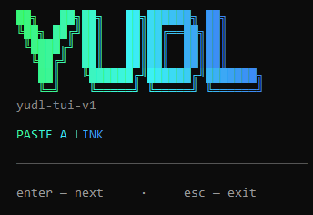

# yudl-tui-v1

**English** | [Українська](README.uk.md)

<p align="center">
  
</p>

**YouTube downloader with a terminal interface.** Go + [bubbletea](https://github.com/charmbracelet/bubbletea).
No GUI, no Python, no extra files.

Version **1** · author **RoboLask** · license **MIT**

## Features

- Interactive wizard: link → video/audio → quality/format → progress.
- Animated iridescent gradient in the logo, headings and progress bar.
- Gradient color is set in the settings: red, green or turquoise.
- Interface languages: **English**, **Українська**.
- **Video** — ready-made MP4 streams are merged without re-encoding.
- **Audio M4A** — the original AAC stream is copied without re-encoding.
- **MP3 / WAV / FLAC** — a single audio extraction pass.
- **FFmpeg and yt-dlp** are found automatically or downloaded once next to the program.
- A single source file — `main.go`.

## Running

Go 1.24+ is required.

```bash
# clone the repository
git clone https://github.com/RoboLask/yudl-tui-v1
cd yudl-tui-v1

# from source
go run main.go

# build
go build -o bin/yudl.exe .    # Windows
go build -o bin/yudl .        # Linux / macOS
```

A ready-to-run binary is in `bin/yudl.exe`.

## Linux

> **Note:** Linux support is prepared but **not tested yet**. The code
> cross-compiles for Linux, but the program has not been run on Linux.

```bash
go build -o bin/yudl .
./bin/yudl
```

- Run the program from a folder you can write to (for example `~/yudl`):
  `settings.json`, `ffmpeg/` and `tools/` are created next to the binary.
  If the binary is in a read-only location such as `/usr/bin`, saving settings
  and downloading FFmpeg / yt-dlp will not work.
- `Ctrl+V` needs `wl-clipboard` (Wayland) or `xclip` / `xsel` (X11).
  Terminal paste (usually `Ctrl+Shift+V`) works without these packages.
- FFmpeg is taken from `PATH`, `/usr/local/bin`, `/usr/bin` or downloaded as a
  static build into `ffmpeg/`.

Clipboard packages:

```bash
sudo apt install wl-clipboard   # Wayland
sudo apt install xclip          # X11
```

## Settings

All settings live in **`settings.json`** next to the program (in the project
root). You can use `//` comments inside it — the program ignores them.
Change the values, save the file and restart the program.

```json
{
  // Folder where downloads are saved.
  // Leave "" to use the system Downloads folder automatically,
  // or put your own path, for example "D:/Video".
  "output_path": "",

  // Interface language: "en" (English) or "uk" (Українська).
  "language": "en",

  // Gradient color: "red", "green" or "turquoise".
  "color_theme": "turquoise"
}
```

| Field | What it sets | Options |
|---|---|---|
| `output_path` | download folder | `""` — auto (system Downloads), or any folder: `C:/Users/me/Downloads`, `D:/Video` |
| `language` | interface language | `en` — English, `uk` — Українська |
| `color_theme` | gradient color | `red`, `green`, `turquoise` |

Defaults: empty `output_path` (auto-detected system Downloads), `en`,
`turquoise`. If the file is missing, the program creates it automatically.
Set `output_path` manually at any time — the program will use it as is.

## FFmpeg

FFmpeg is downloaded into the `ffmpeg/` folder next to the program if it is not
found nearby, in `PATH` or in the standard locations.

- **Windows** — `github.com/yt-dlp/FFmpeg-Builds` (fallback: `github.com/BtbN/FFmpeg-Builds`)
- **Linux** — `github.com/BtbN/FFmpeg-Builds` (fallback: `johnvansickle.com`)
- **macOS** — `osxexperts.net`

You can point to your own copy with the `YUDL_FFMPEG` environment variable.

`yt-dlp` is downloaded into the `tools/` folder next to the program, so the
program root stays clean.

## Project structure

```
main.go        all program code
go.mod         module and dependencies
go.sum         dependency checksums
README.md      English readme
README.uk.md   Ukrainian readme
settings.json  settings (with comments)
LICENSE        MIT license
bin/           built binary
ffmpeg/        downloaded FFmpeg (created automatically)
tools/         downloaded yt-dlp (created automatically)
```

## License

[MIT](LICENSE) © 2026 RoboLask
