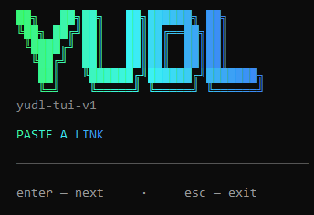

# yudl-tui-v1

[English](README.md) | **Українська**

<p align="center">
  
</p>

**YouTube-завантажувач з термінальним інтерфейсом.** Go + [bubbletea](https://github.com/charmbracelet/bubbletea).
Без GUI, Python і зайвих файлів.

Версія **1** · автор **RoboLask** · ліцензія **MIT**

## Можливості

- Інтерактивний майстер: посилання → відео/аудіо → якість/формат → прогрес.
- Переливний градієнт у логотипі, заголовках і смузі прогресу.
- Колір градієнта задається в налаштуваннях: червоний, зелений або бірюзовий.
- Мови інтерфейсу: **English**, **Українська**.
- **Відео** — готові MP4-потоки склеюються без перекодування.
- **Аудіо M4A** — оригінальний AAC копіюється без перекодування.
- **MP3 / WAV / FLAC** — один прохід вилучення звуку.
- **FFmpeg і yt-dlp** знаходяться автоматично або завантажуються один раз поруч із програмою.
- Один файл вихідного коду — `main.go`.

## Запуск

Потрібен Go 1.24+.

```bash
# з вихідного коду
go run main.go

# збірка
go build -o bin/yudl.exe .    # Windows
go build -o bin/yudl .        # Linux / macOS
```

Готовий бінарник — `bin/yudl.exe`.

## Linux

> **Примітка:** підтримку Linux підготовлено, але ще **не перевірено**.
> Код збирається під Linux, проте програма на Linux ще не запускалася.

```bash
go build -o bin/yudl .
./bin/yudl
```

- Запускай програму з папки, куди є запис (наприклад `~/yudl`):
  `settings.json`, `ffmpeg/` і `tools/` створюються поруч із бінарником.
  Якщо бінарник лежить у місці лише для читання (наприклад `/usr/bin`),
  збереження налаштувань і завантаження FFmpeg / yt-dlp не працюватимуть.
- `Ctrl+V` потребує `wl-clipboard` (Wayland) або `xclip` / `xsel` (X11).
  Вставка термінала (зазвичай `Ctrl+Shift+V`) працює й без цих пакетів.
- FFmpeg береться з `PATH`, `/usr/local/bin`, `/usr/bin` або завантажується
  статичною збіркою в `ffmpeg/`.

Пакети для буфера обміну:

```bash
sudo apt install wl-clipboard   # Wayland
sudo apt install xclip          # X11
```

## Налаштування

Усі налаштування лежать у файлі **`settings.json`** поруч із програмою (у корені
проєкту). У ньому можна писати коментарі `//` — програма їх ігнорує.
Змінюєш значення, зберігаєш файл і перезапускаєш програму.

```json
{
  // Папка, куди зберігаються завантаження.
  // Залиш "" — програма сама візьме системну папку завантажень,
  // або впиши свій шлях, наприклад "D:/Video".
  "output_path": "",

  // Мова інтерфейсу: "en" (English) або "uk" (Українська).
  "language": "en",

  // Колір градієнта: "red", "green" або "turquoise".
  "color_theme": "turquoise"
}
```

| Поле | Що задає | Варіанти |
|---|---|---|
| `output_path` | папка для завантажень | `""` — автоматично (системна папка завантажень), або будь-яка папка: `C:/Users/me/Downloads`, `D:/Video` |
| `language` | мова інтерфейсу | `en` — English, `uk` — Українська |
| `color_theme` | колір градієнта | `red`, `green`, `turquoise` |

За замовчуванням: порожній `output_path` (системна папка завантажень
визначається автоматично), `en`, `turquoise`. Якщо файлу немає, програма
створить його сама. Шлях можна вписати вручну будь-коли — програма
використає його як є.

## FFmpeg

FFmpeg завантажується в папку `ffmpeg/` поруч із програмою, якщо його не знайдено
поруч, у `PATH` або стандартних каталогах.

- **Windows** — `github.com/yt-dlp/FFmpeg-Builds` (запасний: `github.com/BtbN/FFmpeg-Builds`)
- **Linux** — `github.com/BtbN/FFmpeg-Builds` (запасний: `johnvansickle.com`)
- **macOS** — `osxexperts.net`

Свій шлях можна вказати змінною `YUDL_FFMPEG`.

`yt-dlp` завантажується в папку `tools/` поруч із програмою, щоб корінь
програми залишався чистим.

## Структура проєкту

```
main.go        весь код програми
go.mod         модуль і залежності
go.sum         контрольні суми залежностей
README.md      англійський readme
README.uk.md   український readme
settings.json  налаштування (з коментарями)
LICENSE        ліцензія MIT
bin/           зібраний бінарник
ffmpeg/        завантажений FFmpeg (створюється автоматично)
tools/         завантажений yt-dlp (створюється автоматично)
```

## Ліцензія

[MIT](LICENSE) © 2026 RoboLask
